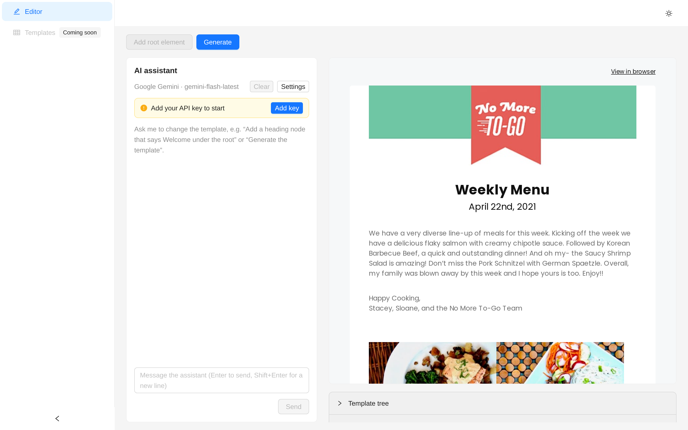
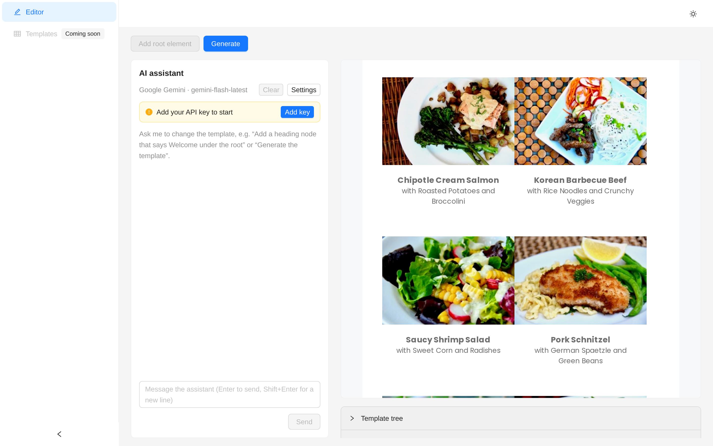
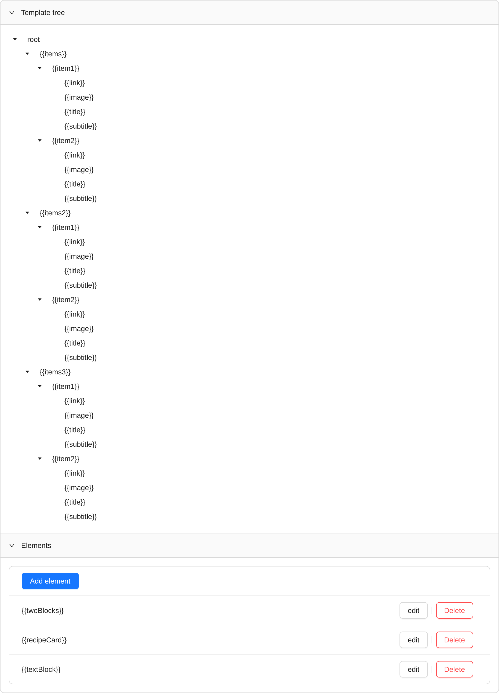
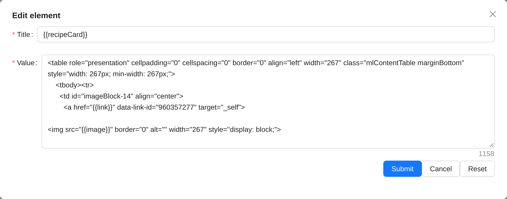
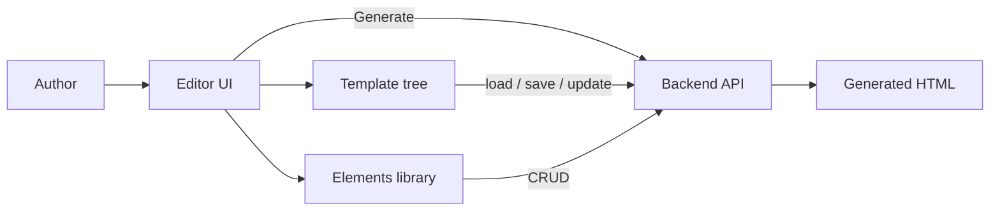
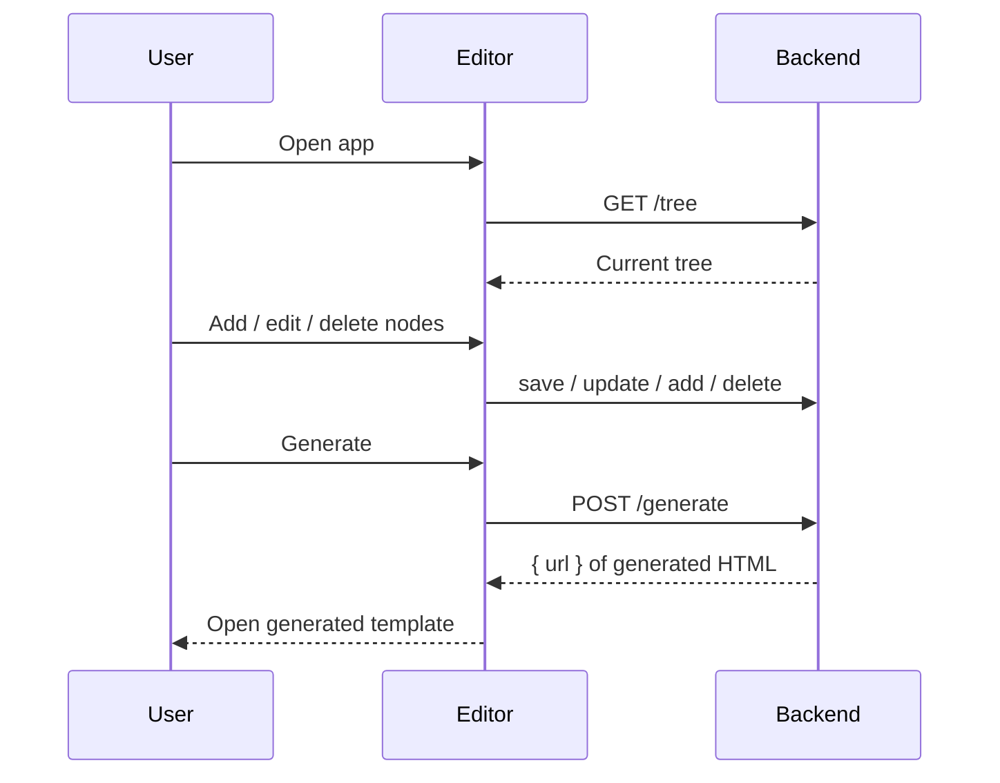
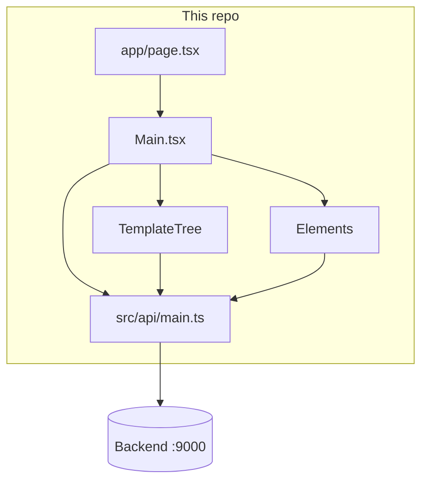

# Email Template Editor

A visual editor for building HTML email templates as a tree of blocks. Authors compose structure, reuse elements, and generate a ready-to-send template without hand-editing raw HTML.

Built with **Next.js** (App Router), **React**, **Ant Design**, and **Vitest**.



## Goal

Give non-specialists (and developers) a reliable way to assemble email templates from reusable blocks, keep the structure consistent, and export HTML that a backend can render or store.

## Problems it solves

| Problem | How this app helps |
| --- | --- |
| Email HTML is fragile and hard to edit by hand | Structure is a tree of elements instead of a single HTML blob |
| Teams reinvent the same header/footer/CTA | Shared **Elements** library can be reused across templates |
| Design and code drift apart | Visual tree + generate step keeps the output tied to the model |
| Hard to see the hierarchy of a template | Tree view with add / edit / delete on each node |
| Generating a final file is manual | **Generate** calls the backend and returns a link to the result |

## Screenshots

All screenshots use the sample data that ships with the [backend](https://github.com/LLazyEmail/email-template-editor-nodejs): a No More To-Go "Weekly Menu" issue with six recipes.

### Live preview

The preview renders the template tree as the final email. Here are the recipe rows: each row is a `{{twoBlocks}}` element holding two `{{recipeCard}}` elements.



### Template tree and Elements library

Both panels sit under the preview and are collapsed by default. Each placeholder in a node's HTML becomes a child node (`{{item1}}`, `{{link}}`, `{{image}}`, …). Right-click a node to add a child, edit it, or delete it. The Elements library holds the reusable blocks: `{{twoBlocks}}` (two-column row), `{{recipeCard}}` (photo, title and subtitle) and `{{textBlock}}` (a paragraph).



### Editing an element

The title is the placeholder used in the tree (`{{recipeCard}}`). The value is the HTML it expands to, with its own placeholders.



### Regenerating the screenshots

Start the backend on `:9000` with the sample `db.json` and run `npm run dev`. Then capture the editor at 1440×900 (device scale 2): the overview, the preview scrolled to the first recipe row, both panels expanded, and the **edit** modal of `{{recipeCard}}`. Hide the Next.js dev badge before you capture.

## How it works





## Features

- Add a root element and grow a template tree
- Context menu on each node: add, edit, delete
- Live preview of the email next to the AI assistant
- Template tree and element library in collapsible panels for manual edits
- Elements library with create, edit, and delete
- One-click generate that returns a link to the HTML
- AI assistant that edits the template on request (Gemini, OpenAI or Anthropic, with your own API key)
- Build an issue from pasted text: the assistant lays the content out in blocks from your element library
- Ant Design UI
- Talks to a separate backend (default `http://localhost:9000`, override with `NEXT_PUBLIC_API_URL`)

## Architecture



## Getting started

```bash
npm install
npm run dev
```

Open [http://localhost:3000](http://localhost:3000).

The frontend expects a backend on port **9000**. Override the base URL with `NEXT_PUBLIC_API_URL`.

### Scripts

| Command | Purpose |
| --- | --- |
| `npm run dev` | Next.js development server |
| `npm run lint` | ESLint (Next.js rules + architecture import rules) |
| `npm run typecheck` | TypeScript check (`tsc --noEmit`) |
| `npm run format` | Format with Prettier (`format:check` runs in CI) |
| `npm test` | Run Vitest once |
| `npm run test:watch` | Vitest in watch mode |
| `npm run build` | Production build |
| `npm start` | Start the production server |

### Docker

```bash
docker build -t email-template-editor .
docker run -p 3000:3000 email-template-editor
```

## AI assistant

The assistant sits on the left of the editor, next to the preview. Open **Settings** (or **Add key**), choose a provider (Google Gemini, OpenAI or Anthropic), paste your own API key, and ask for changes in plain language, e.g. "add a heading that says Welcome under the root". The assistant reads the tree and element library, adds, edits or deletes nodes and elements, and can generate the template. It asks before deleting anything.

**Build an issue from text.** Paste the issue's content (an intro, a few recipes with titles, links and photos) and ask the assistant to build the email. It picks matching blocks from the element library, fills them with your text and adds them after the current content in one step; the preview updates right away. Ask it to "replace" the content to swap out the current blocks instead (it asks first). It uses only library elements, never new HTML, so the email stays within your approved design. Content that fits no element is listed in the reply, so you know which element to add. The assistant judges elements by their placeholders and HTML, so clear placeholder names (`{{image}}`, `{{link}}`, `{{title}}`) help it choose.

**Where your key goes.** The key is kept in your browser and sent only to the provider you chose; the editor's backend never sees it. By default it is kept for the current tab (`sessionStorage`). You can also keep it for the current page only, or remember it on the device (`localStorage`), and you can remove it at any time in the assistant settings. Any script running on the page, including browser extensions, could read the key, so use a key with a spending limit and revoke it if in doubt. A Content-Security-Policy blocks injected scripts and lets the page talk only to the editor's backend and the LLM providers.

## Project layout

```
app/                    Next.js App Router (layout, page)
src/
  api/                  Axios client and types
  ai/                   AI assistant: providers, tools, agent loop, key storage
  editor/Main/           Editor UI (tree, elements, forms, AI chat)
  types/                Shared types
AGENTS.md               Guide for AI coding agents
docs/AI_AGENT.md        Extended agent reference
docs/screenshots/       Screenshots used in this README
.claude/skills/         Claude skills (best practices)
```

## For AI agents

If you are an AI coding agent, read these before changing code:

- [`AGENTS.md`](AGENTS.md) — layout, conventions, what to avoid
- [`docs/AI_AGENT.md`](docs/AI_AGENT.md) — data flow and file roles
- [`.claude/skills/`](.claude/skills/) — software development best practices for Claude

## Related work

- Migrated from Create React App to Next.js + Vitest in PR #15.
- Agent documentation and README expansion live in PR #16.
