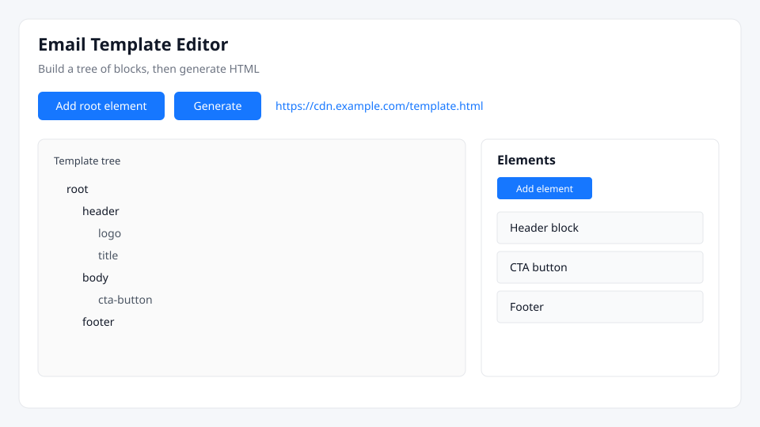
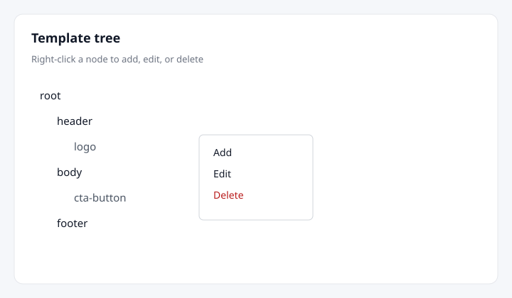
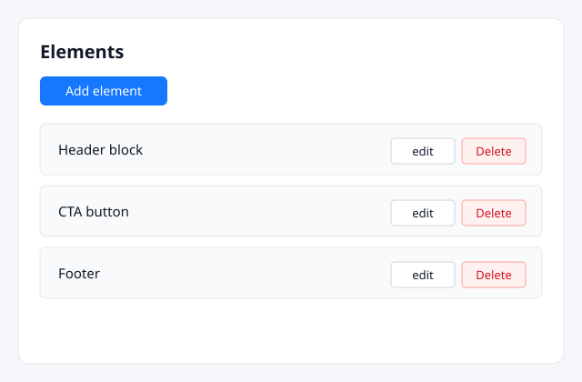
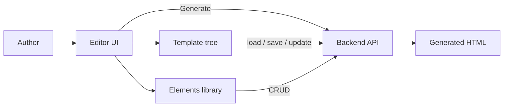
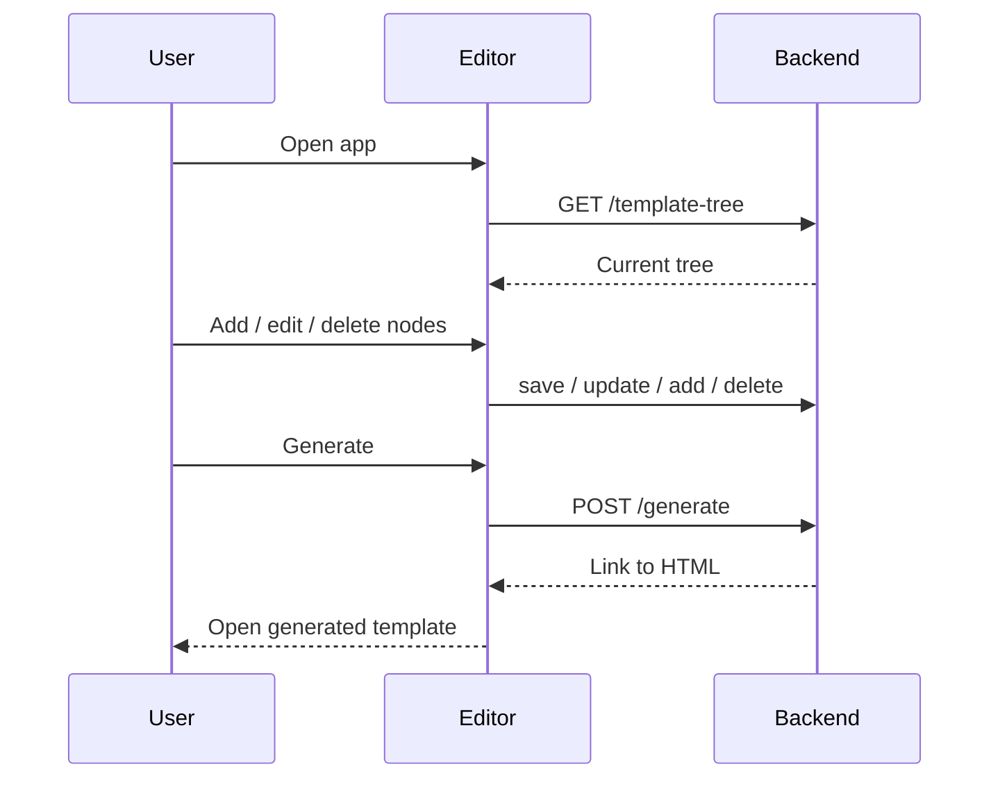
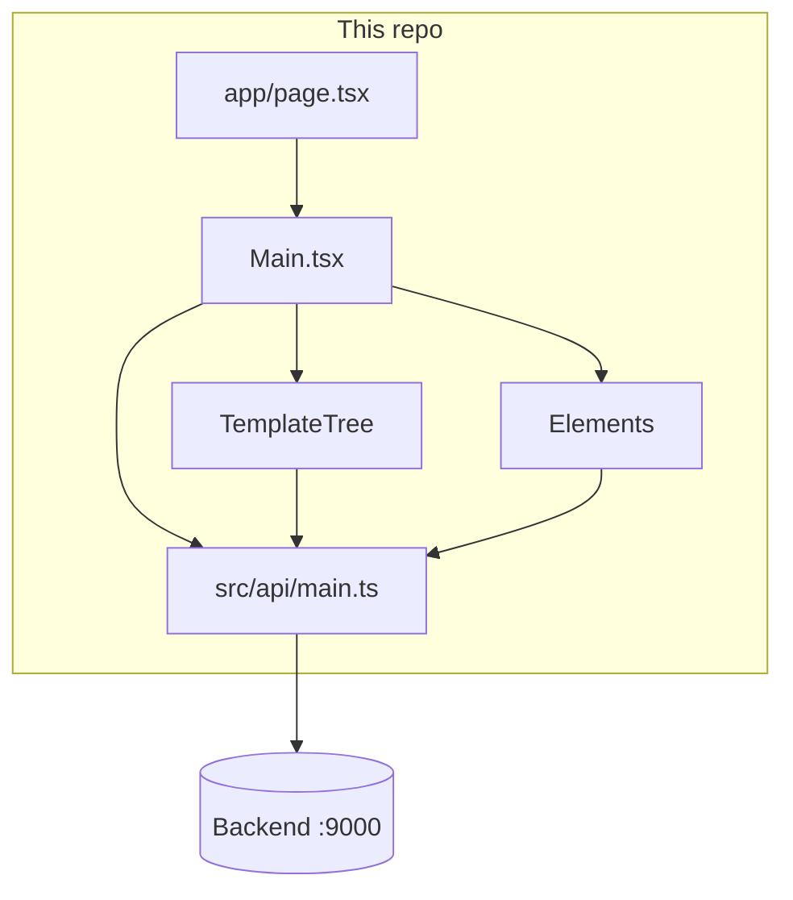

# Email Template Editor

A visual editor for building HTML email templates as a tree of blocks. Authors compose structure, reuse elements, and generate a ready-to-send template without hand-editing raw HTML.

Built with **Next.js** (App Router), **React**, **Ant Design**, and **Vitest**.



## Goal

Give non-specialists (and developers) a reliable way to assemble email templates from reusable blocks, keep the structure consistent, and export HTML that a backend can render or store.

## Problems it solves

| Problem | How this app helps |
| --- | --- |
| Email HTML is fragile and hard to edit by hand | Structure is a tree of elements instead of a single HTML blob |
| Teams reinvent the same header/footer/CTA | Shared **Elements** library can be reused across templates |
| Design and code drift apart | Visual tree + generate step keeps the output tied to the model |
| Hard to see the hierarchy of a template | Tree view with add / edit / delete on each node |
| Generating a final file is manual | **Generate** calls the backend and returns a link to the result |

## Screenshots

### Template tree

Right-click a node to add a child, edit the current node, or delete it.



### Elements library

Maintain the reusable blocks that can be dropped into the tree.



## How it works





## Features

- Add a root element and grow a template tree
- Context menu on each node: add, edit, delete
- Elements library with create, edit, and delete
- One-click generate that returns a link to the HTML
- Ant Design UI
- Talks to a separate backend (default `http://localhost:9000`, override with `NEXT_PUBLIC_API_URL`)

## Architecture



## Getting started

```bash
npm install
npm run dev
```

Open [http://localhost:3000](http://localhost:3000).

The frontend expects a backend on port **9000**. Override the base URL with `NEXT_PUBLIC_API_URL`.

### Scripts

| Command | Purpose |
| --- | --- |
| `npm run dev` | Next.js development server |
| `npm test` | Run Vitest once |
| `npm run test:watch` | Vitest in watch mode |
| `npm run build` | Production build |
| `npm start` | Start the production server |

### Docker

```bash
docker build -t email-template-editor .
docker run -p 3000:3000 email-template-editor
```

## Project layout

```
app/                    Next.js App Router (layout, page)
src/
  api/                  Axios client and types
  editor/Main/           Editor UI (tree, elements, forms)
  types/                Shared types
AGENTS.md               Guide for AI coding agents
docs/AI_AGENT.md        Extended agent reference
docs/screenshots/       UI illustrations used in this README
.claude/skills/         Claude skills (best practices)
```

## For AI agents

If you are an AI coding agent, read these before changing code:

- [`AGENTS.md`](AGENTS.md) — layout, conventions, what to avoid
- [`docs/AI_AGENT.md`](docs/AI_AGENT.md) — data flow and file roles
- [`.claude/skills/`](.claude/skills/) — software development best practices for Claude

## Related work

- Migrated from Create React App to Next.js + Vitest in PR #15.
- Agent documentation and README expansion live in PR #16.
